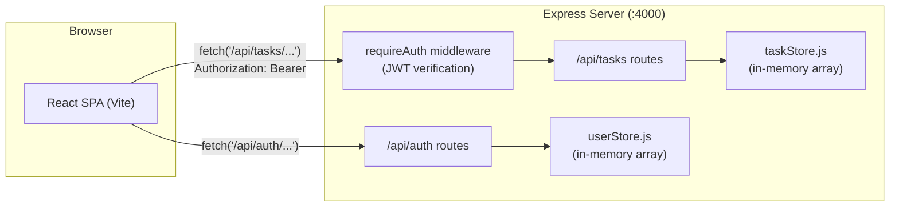

# TaskFlow — Full-Stack Todo List Application

A full-stack task manager with per-user accounts, JWT authentication, task priorities, and a dark-mode-capable, professionally styled UI. Built with a React (Vite) frontend and an Express backend, developed story-by-story using the [squad-kit](.squad/) planning workflow.

## Overview

TaskFlow lets a registered user create, edit, complete, and delete personal to-do items. Every task belongs to exactly one user — no one can see or modify another user's tasks. Tasks carry a priority (`low` / `medium` / `high`) that can be filtered and sorted client-side. The UI includes a light/dark theme toggle, a redesigned SaaS-style dashboard (gradient header, stat cards, skeleton loading, illustrated empty states), and inline client-side form validation.

Data is stored **in memory** on the server (plain JS arrays) — there is no database. All users and tasks are lost when the server process restarts. This is a deliberate scope decision carried through every implemented story, not an oversight.

## Features

| Feature | Status |
|---|---|
| Todo CRUD (create, edit title, delete) | ✅ Implemented |
| Mark task pending / completed | ✅ Implemented |
| User registration / login / logout | ✅ Implemented |
| JWT authentication (1-hour expiry) | ✅ Implemented |
| Per-user task isolation | ✅ Implemented |
| Task priorities (low / medium / high, default medium) | ✅ Implemented |
| Priority filtering (client-side) | ✅ Implemented |
| Priority sorting, high↔low (client-side) | ✅ Implemented |
| Username / display name | ✅ Implemented |
| UI/UX visual redesign (gradient header, icons, stat cards, skeleton loading) | ✅ Implemented |
| Dark mode (toggle, persisted, system-preference aware) | ✅ Implemented |
| Frontend form validation (email format, required fields, task title) | ✅ Implemented |
| Password reset / email verification | ❌ Not implemented |
| Persistent storage (database) | ❌ Not implemented |
| Username uniqueness / editing | ❌ Not implemented |

## Tech Stack

### Frontend
- **React** 18.3.1 (function components + hooks, no Redux/state library)
- **Vite** 5.3.1 (dev server + build), with a dev proxy for `/api` → `http://localhost:4000`
- Plain CSS (`index.css`, ~1,450 lines) using CSS custom properties — no Tailwind, no CSS-in-JS, no UI component library
- Hand-rolled inline SVG icons (`components/icons.jsx`) — no icon library dependency

### Backend
- **Node.js** + **Express** 4.19.2
- **jsonwebtoken** 9.0.2 (JWT signing/verification)
- **bcryptjs** 2.4.3 (password hashing)
- **cors** 2.8.5

### Testing
- **Server:** Jest 29 + Supertest 7 (HTTP-level route tests against the exported Express `app`)
- **Client:** Vitest 1.6.0 + React Testing Library 16 + jsdom

### Build / Development Tools
- Vite (client dev server & production build)
- nodemon (backend auto-reload in development)

## Architecture

The client is a single-page React app served by Vite. In development, Vite proxies any `/api/*` request to the Express server on port 4000. The client never talks to a database directly — all state lives behind the Express API, which itself keeps everything in process memory (two plain arrays: one for users, one for tasks).



## Project Structure

```
.
├── client/                        # React + Vite frontend
│   ├── index.html                 # HTML entry; inline script sets data-theme before React mounts
│   ├── vite.config.js             # Dev proxy (/api → :4000) + Vitest config
│   └── src/
│       ├── main.jsx                # React root, wraps <App/> in <AuthProvider>
│       ├── App.jsx                 # Top-level screen switch + TaskDashboard
│       ├── index.css               # Design-token system (light + dark)
│       ├── api/
│       │   ├── authApi.js          # register()/login() fetch wrappers
│       │   └── tasksApi.js         # Task CRUD fetch wrappers (attaches JWT)
│       ├── auth/
│       │   └── tokenStorage.js     # localStorage helpers for token + username
│       ├── context/
│       │   └── AuthContext.jsx     # useAuth() — token/username state, login/register/logout
│       ├── hooks/
│       │   └── useTheme.js         # Theme state, persistence, system-preference detection
│       ├── utils/
│       │   └── validation.js       # isValidEmail()
│       └── components/
│           ├── TaskForm.jsx        # Add-task form (title + priority)
│           ├── TaskItem.jsx        # Single task row (status, priority, inline edit)
│           ├── TaskList.jsx        # List / empty states
│           ├── LoginPage.jsx / RegisterPage.jsx
│           ├── ThemeToggle.jsx     # Light/dark switch (role="switch")
│           └── icons.jsx           # Inline SVG icon set
├── server/                        # Express backend
│   └── src/
│       ├── index.js                # Server entry (listens on PORT || 4000)
│       ├── app.js                  # Express app: cors, json body, route mounting
│       ├── authMiddleware.js       # signToken(), requireAuth() (JWT verification)
│       ├── userStore.js            # In-memory user store
│       ├── taskStore.js            # In-memory task store (per-user scoped)
│       └── routes/
│           ├── auth.js             # POST /register, POST /login
│           └── tasks.js            # Task CRUD + status/priority routes
└── .squad/                        # squad-kit planning artifacts (plans, stories, config)
```

## Frontend

- **`App.jsx`** exports a top-level `App` component that reads `useAuth().isAuthenticated`. When unauthenticated it toggles between `LoginPage` and `RegisterPage`; when authenticated it renders `TaskDashboard`, which owns all task state (`tasks`, `loading`, `error`, `sortOrder`, `filterPriority`) and derives the visible, sorted/filtered task list on every render.
- **Components** are plain, prop-driven function components: `TaskForm` (title + priority input), `TaskItem` (view/edit modes, status checkbox, priority `<select>`), `TaskList` (renders `TaskItem`s or an empty state), `LoginPage`/`RegisterPage` (controlled forms with inline validation), and `ThemeToggle` (an accessible switch button).
- **API layer** (`api/authApi.js`, `api/tasksApi.js`) wraps `fetch` against `/api/...`. `tasksApi.js` attaches an `Authorization: Bearer <token>` header (via `auth/tokenStorage.js`) to every request and tags thrown errors with `error.status` so callers can special-case a `401` (expired/invalid token → automatic logout).
- **Authentication/token handling**: `context/AuthContext.jsx` exposes a `useAuth()` hook (`isAuthenticated`, `username`, `login`, `register`, `logout`). The JWT and the display username are persisted to `localStorage` (`todo_auth_token`, `todo_auth_username`) by `auth/tokenStorage.js`, so a page refresh keeps the user logged in.
- **Theme handling**: `hooks/useTheme.js` is a plain hook (no React Context) that reads/writes `localStorage['todo_theme_preference']`, falls back to `window.matchMedia('(prefers-color-scheme: dark)')` when nothing is stored, and sets `data-theme` on `<html>`. A small blocking `<script>` in `client/index.html` sets `data-theme` before any React code runs, preventing a flash of the wrong theme.
- **Validation utilities**: `utils/validation.js` exports `isValidEmail()`, a regex-based email format check (`/^[^\s@]+@[^\s@]+\.[^\s@]+$/`) used by both `LoginPage` and `RegisterPage`.
- **Styling/design tokens**: `index.css` defines a single `:root` block of CSS custom properties (colors, gradients, spacing, radii, shadows, font sizes, transitions) plus a `:root[data-theme="dark"]` block that redefines the same token names with an independently designed dark palette (not an inverted copy). Every component's CSS reads these tokens, so the same class rules render correctly in both themes.

## Backend

- **`app.js`** builds the Express app: `cors()` (open, no origin restriction), `express.json()`, mounts `authRouter` at `/api/auth` (public) and `tasksRouter` at `/api/tasks` behind `requireAuth` (protected).
- **Routes**
  - `routes/auth.js` — `POST /register`, `POST /login`. Both hash/verify passwords with `bcryptjs` and return `{ token, user }` on success.
  - `routes/tasks.js` — `GET /`, `POST /`, `PUT /:id`, `DELETE /:id`, `PATCH /:id/status`, `PATCH /:id/priority`, all scoped to `req.userId` set by the auth middleware.
- **Authentication middleware** (`authMiddleware.js`): `signToken(user)` signs a JWT (`{ sub, email }` payload, 1-hour expiry) with `process.env.JWT_SECRET` (or a hardcoded dev fallback). `requireAuth` parses the `Authorization: Bearer <token>` header, verifies the JWT, and attaches `req.userId`; it returns `401` for a missing/malformed header or an invalid/expired token.
- **User/task storage**: `userStore.js` and `taskStore.js` each hold a module-level array and an incrementing id counter — no persistence layer. Both expose a `reset()` used only by the test suites. Typed errors (`ValidationError`, `ConflictError`, `NotFoundError`) are thrown by the stores and mapped to HTTP status codes by each router's `handleStoreError` helper.
- **API behavior**: task lookups are always scoped by `userId` (`tasks.find(t => t.id === id && t.userId === userId)`); a task id that exists but belongs to another user is treated identically to a non-existent id and returns `404`, never `403` — this deliberately avoids confirming a task id exists to a non-owner.

## Authentication

1. **Registration** — `POST /api/auth/register` with `{ email, username, password }`. The server rejects a password under 6 characters, an empty email, or an empty/whitespace username with `400`, and a duplicate email with `409` (usernames are **not** required to be unique — two users can share one). On success it hashes the password with bcrypt (10 salt rounds) and returns `{ token, user: { id, email, username } }`.
2. **Login** — `POST /api/auth/login` with `{ email, password }`. Returns the same `{ token, user }` shape on success, or a generic `401 "Invalid email or password"` for either an unknown email or a wrong password (so the client cannot distinguish the two cases).
3. **JWT** — signed with `jsonwebtoken`, payload `{ sub: userId, email }`, 1-hour (`1h`) expiry, secret from `process.env.JWT_SECRET` (falls back to a hardcoded development secret when unset).
4. **Token storage** — the client stores the JWT and the display username in `localStorage` (`todo_auth_token`, `todo_auth_username`), so a page refresh preserves the session.
5. **Authenticated requests** — every `/api/tasks*` call attaches `Authorization: Bearer <token>`. A `401` response (missing/invalid/expired token) causes the client to clear stored credentials and return to the login screen.
6. **User-specific tasks** — `requireAuth` resolves `req.userId` from the verified token; every task store function filters/looks up by that id, so users only ever see and mutate their own tasks.

## Todo / Task Management

- **Create** — `TaskForm` submits a trimmed, required title plus a priority (defaults to `medium` in the form); the server independently re-validates and rejects an empty/whitespace-only title with `400`.
- **Read** — `GET /api/tasks` returns only the authenticated user's tasks.
- **Update title** — inline edit mode in `TaskItem`, saved via `PUT /api/tasks/:id`.
- **Delete** — `DELETE /api/tasks/:id`.
- **Toggle status** — a checkbox on each task calls `PATCH /api/tasks/:id/status` with `{ status: 'pending' | 'completed' }`.
- **Change priority** — a per-task `<select>` calls `PATCH /api/tasks/:id/priority` with `{ priority: 'low' | 'medium' | 'high' }`, independent of title/status edits.

## Priority System

- Every task has a priority of `low`, `medium`, or `high`; **`medium`** is the default when a client creates a task without specifying one.
- Priority can be changed at any time via a dedicated control, independent of the title or completion status.
- **Filtering**: a "Filter by priority" dropdown (`all` / `low` / `medium` / `high`) narrows the visible list; filtering is done entirely client-side over the already-fetched task list.
- **Sorting**: a "Sort by priority" dropdown offers `None`, `High to Low`, and `Low to High`; also purely client-side (`PRIORITY_RANK` comparator in `App.jsx`), with no server-side sort parameter.
- Each priority is shown as a labeled badge (text + icon + color), so it is distinguishable by more than color alone.

## Username

- Collected as a required field during registration (rejects empty/whitespace with `400`); intentionally **not** unique — two accounts may share a username.
- Login remains email + password only; there is no "log in with username" path.
- The username is returned in the register/login response and persisted client-side (`localStorage`), then displayed on the dashboard header as "Logged in as `<username>`" next to an avatar showing the username's first initial, falling back to "you" if no username is available.

## UI/UX

The dashboard, login, and register screens share one visual system built on the CSS token layer described below:

- A gradient (indigo → violet) header/brand panel and primary buttons, used selectively rather than on every surface.
- A stats strip on the dashboard (Total / Pending / Completed), computed client-side from the already-fetched task list — not a separate API call.
- A hand-rolled inline SVG icon set (`components/icons.jsx`) for priorities, status, and actions — every icon is `aria-hidden`/`focusable="false"` so it never changes an element's accessible name.
- Elevated task cards with soft shadows, hover motion, and a priority-accent treatment.
- A skeleton-loader loading state (shimmering placeholder cards) instead of a spinner.
- An illustrated empty state (inline SVG) with two distinct messages: "No tasks yet…" vs. "No tasks match the selected priority filter."
- Split-panel Login/Register pages: a decorative gradient brand panel beside the form on wide viewports, collapsing to a single centered card on narrow ones.
- Responsive layout from roughly 360px up through 1440px+, with no new npm dependency added for any of this.

## Dark Mode

- **Toggle**: an accessible `ThemeToggle` button (`role="switch"`, `aria-checked`, `aria-label="Switch to light/dark mode"`) appears on the Login screen, Register screen, and the Task Dashboard header.
- **System preference**: on first visit with no stored choice, the app renders using `window.matchMedia('(prefers-color-scheme: dark)')`.
- **Persistence**: once a user explicitly toggles the theme, that choice is written to `localStorage['todo_theme_preference']` and takes precedence over the system preference on every subsequent load, including after a refresh.
- **No flash of unstyled/wrong theme**: a small blocking `<script>` in `client/index.html` reads the stored preference (or system preference) and sets `data-theme` on `<html>` before the React bundle loads.
- **CSS token system**: `index.css` defines all colors as CSS custom properties inside `:root`, then a separate `:root[data-theme="dark"]` block redefines the same variable names with an independently designed dark palette (four layered surface steps, its own accent hues, and dark-tuned shadows) rather than a simple lightness inversion. Every component consumes the variables, so no per-component dark-mode styling is needed. Theme changes animate via the existing `--transition-base`/`--transition-fast` tokens and respect `prefers-reduced-motion`.

## Validation

Frontend validation is implemented and runs independently of (in addition to) server-side checks:

- **Login form** (`LoginPage.jsx`): email is required and must match an email-shaped pattern (`utils/validation.js`'s `isValidEmail`); password is required. Errors appear after a field is blurred ("touched") or after a failed submit attempt, with `aria-invalid`/`aria-describedby` wired to a visible `role="alert"` message.
- **Register form** (`RegisterPage.jsx`): the same email/password rules, plus a required, non-empty username field.
- **Task form / inline task edit** (`TaskForm.jsx`, `TaskItem.jsx`): the task title must be non-empty after trimming; an inline error is shown on blur or failed submit, and the parent `onAdd`/`onEdit` callback is never invoked while the field is invalid.
- All forms set `noValidate` on the `<form>` element, replacing native browser validation UI with this custom JavaScript validation.

## API Reference

All `/api/tasks*` routes require a valid `Authorization: Bearer <token>` header; `/api/auth/*` routes are public.

| Method | Route | Auth | Purpose | Key request fields | Response behavior |
|---|---|---|---|---|---|
| POST | `/api/auth/register` | No | Create a new account | `email`, `username`, `password` (≥ 6 chars) | `201` + `{ token, user: { id, email, username } }`; `400` on short password, invalid email, or empty username; `409` on duplicate email |
| POST | `/api/auth/login` | No | Authenticate and receive a JWT | `email`, `password` | `200` + `{ token, user }`; `401` (generic message) on unknown email or wrong password |
| GET | `/api/tasks` | Yes | List the authenticated user's tasks | — | `200` + array of tasks (never includes other users' tasks) |
| POST | `/api/tasks` | Yes | Create a task | `title` (required), `priority` (optional, defaults `medium`) | `201` + created task; `400` on empty title or invalid priority |
| PUT | `/api/tasks/:id` | Yes | Update a task's title | `title` (required) | `200` + updated task; `400` on empty title; `404` if not found or not owned |
| DELETE | `/api/tasks/:id` | Yes | Delete a task | — | `204` no body; `404` if not found or not owned |
| PATCH | `/api/tasks/:id/status` | Yes | Toggle pending/completed | `status`: `'pending'` \| `'completed'` | `200` + updated task; `400` on invalid status; `404` if not found or not owned |
| PATCH | `/api/tasks/:id/priority` | Yes | Change priority | `priority`: `'low'` \| `'medium'` \| `'high'` | `200` + updated task; `400` on invalid priority; `404` if not found or not owned |

## Running the Project

Requires Node.js and npm. The client and server are independent npm packages (`client/package.json`, `server/package.json`) with no root-level package manifest.

**1. Install dependencies**

```bash
cd server && npm install
cd ../client && npm install
```

**2. Start the backend** (listens on `http://localhost:4000` by default)

```bash
cd server
npm run dev     # nodemon, auto-restarts on change
# or
npm start       # node src/index.js
```

**3. Start the frontend** (Vite dev server, proxies `/api` to `http://localhost:4000`)

```bash
cd client
npm run dev
```

**4. Run tests**

```bash
cd server && npm test    # Jest + Supertest
cd client && npm test    # vitest run
```

**5. Build the frontend for production**

```bash
cd client
npm run build            # outputs client/dist
```

## Testing

| Suite | Framework | File | Approx. test count |
|---|---|---|---|
| Server | Jest + Supertest | `server/src/taskStore.test.js` | 16 |
| Server | Jest + Supertest | `server/src/userStore.test.js` | 6 |
| Server | Jest + Supertest | `server/src/routes/auth.test.js` | 8 |
| Server | Jest + Supertest | `server/src/routes/tasks.test.js` | 22 |
| Client | Vitest + RTL | `client/src/App.test.jsx` | 12 |
| Client | Vitest + RTL | `client/src/api/authApi.test.js` | 5 |
| Client | Vitest + RTL | `client/src/components/LoginPage.test.jsx` | 9 |
| Client | Vitest + RTL | `client/src/components/RegisterPage.test.jsx` | 10 |
| Client | Vitest + RTL | `client/src/components/TaskForm.test.jsx` | 7 |
| Client | Vitest + RTL | `client/src/components/TaskItem.test.jsx` | 10 |
| Client | Vitest + RTL | `client/src/components/TaskList.test.jsx` | 3 |
| Client | Vitest + RTL | `client/src/components/ThemeToggle.test.jsx` | 3 |
| Client | Vitest + RTL | `client/src/hooks/useTheme.test.js` | 6 |

Coverage includes: task CRUD and validation (including cross-user access returning `404`), user registration/login validation and error responses, JWT-gated route access, priority defaulting/validation/filter/sort, username propagation, and theme persistence/system-preference/toggle behavior. Run a suite with `npm test` from the corresponding `server/` or `client/` directory.

## Environment Configuration

| Variable | Where used | Default | Purpose |
|---|---|---|---|
| `PORT` | `server/src/index.js` | `4000` | Port the Express server listens on |
| `JWT_SECRET` | `server/src/authMiddleware.js` | `'dev-secret-do-not-use-in-production'` | Secret used to sign/verify JWTs |

There is no `.env` loading mechanism in this repository (no `dotenv` dependency) — set these as real process environment variables if you need non-default values. The client has no environment variables; its dev-server API target (`http://localhost:4000`) is hardcoded in `client/vite.config.js`.

## Development Workflow

This repository was built story-by-story using the [squad-kit](.squad/README.md) planning workflow:

- `.squad/stories/` holds one `intake.md` per feature — the raw requirements fed to the planner.
- `.squad/plans/` holds the generated implementation plans, one numbered story file per feature, tracked centrally in `.squad/plans/00-index.md` (a global sequence number, `NN`, is assigned per story across all features).
- Each story file documents its goal, the exact files to change, edge cases, a test plan, and done criteria, which is how the "Implemented Stories" and "Current Status" sections below were verified against the actual code.

## Implemented Stories

| NN | Feature folder | Story | Status |
|---|---|---|---|
| 01 | `add-todo-task` | Todo Tasks — base CRUD, status toggle | ✅ Implemented |
| 02 | `add-user-authentication` | User Login and Registration — JWT auth, per-user tasks | ✅ Implemented |
| 03 | `add-task-priorities` | Task Priorities — priority field, filter, sort | ✅ Implemented |
| 04 | `add-username` | Username Display Name — collected at registration, shown on dashboard | ✅ Implemented |
| 05 | `improve-todo-ui` | Improve Todo UI/UX — first restyle pass (token layer, buttons, cards) | ✅ Implemented, later superseded visually |
| 06 | `improve-todo-ui` | Visual Redesign (SaaS-grade) — supersedes Story 05's visual output (gradients, icon system, skeleton loading, split-panel auth) | ✅ Implemented |
| 07 | `dark-mode` | Add Dark Mode — theme toggle, persistence, from-scratch dark palette | ✅ Implemented |
| — | `frontend-validation` | Add Frontend Form Validation | ✅ Implemented in code (`utils/validation.js`, inline validation in `LoginPage`, `RegisterPage`, `TaskForm`, `TaskItem`), but `.squad/plans/frontend-validation/00-overview.md` was never filled in with a numbered story file, so this feature has no assigned `NN` in the plan index |

## Current Status

**Implemented and verified in the current codebase:** full task CRUD with status toggling, JWT-based registration/login/logout with per-user task isolation, task priorities with client-side filter and sort, a non-unique username shown on the dashboard, a full visual redesign (gradient header, stat cards, icon system, skeleton loading, illustrated empty states, split-panel auth), a persisted light/dark theme with system-preference detection, and frontend form validation on both auth forms and the task title.

**Not implemented:** any persistent storage (all data is in-memory and resets on every server restart), password reset/forgot-password, OAuth/social login, email verification, username uniqueness or editing, roles/permissions, live cross-tab theme sync, and live OS-theme-change syncing after initial load.

## Future Improvements

The following are reasonable next steps, **not implemented today**:

- Replace in-memory arrays with a real database (e.g. PostgreSQL/SQLite) so data survives a restart.
- Password reset / forgot-password flow and email verification.
- Route-based navigation (e.g. `react-router`) instead of local `view` state switching.
- Server-side pagination, search, and due dates/categories for tasks.
- Rate limiting and refresh tokens for the auth endpoints.
- A CI pipeline running both test suites on every push.

## Security Notes

- Passwords are hashed with `bcryptjs` (10 salt rounds) before storage — plaintext passwords are never persisted.
- `JWT_SECRET` falls back to a hardcoded development value (`server/src/authMiddleware.js`) when the environment variable is unset — **this fallback must never be relied on outside local development.**
- All data (`users`, `tasks`) lives in process memory only: it is lost on restart, cannot be shared across multiple server instances, and has no backup/durability guarantee.
- CORS is enabled with no restrictions (`cors()` with default options) — acceptable for local development, but should be locked down to specific origins before any public deployment.
- The login endpoint returns a deliberately generic `401` message for both "unknown email" and "wrong password" to avoid confirming which emails are registered; the registration endpoint's `409 "email already registered"` response does, by contrast, reveal whether an email is taken.
- There is no rate limiting or brute-force protection on `/api/auth/login` or `/api/auth/register`.
- Cross-user task access (a valid token attempting to read/modify another user's task id) is mapped to `404`, not `403`, so it does not confirm whether the requested task id exists at all.

## License

No license file is present in this repository.
