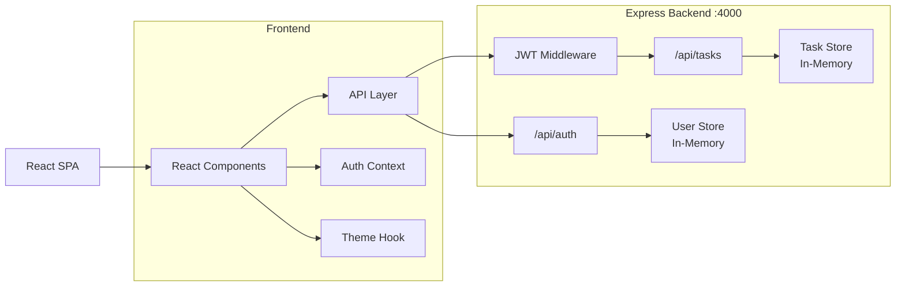

# TaskFlow — Full-Stack Todo List Application


A full-stack Todo List application built with **React, Vite, Node.js, and Express**.

TaskFlow supports user authentication, personal task management, task priorities, dark mode, responsive UI, client-side validation, and automated testing.

The project was developed incrementally using a **story-driven development workflow with Squad Kit**, where each feature was planned, implemented, and tested as a separate story.

> **Note:** Application data is currently stored in memory using JavaScript arrays. There is no database or persistent storage. All users and tasks are lost when the backend server restarts.

---

## Table of Contents

* [Features](#features)
* [Tech Stack](#tech-stack)
* [Architecture](#architecture)
* [Project Structure](#project-structure)
* [Authentication](#authentication)
* [Task Management](#task-management)
* [Priority System](#priority-system)
* [UI/UX](#uiux)
* [Dark Mode](#dark-mode)
* [Validation](#validation)
* [API Reference](#api-reference)
* [Getting Started](#getting-started)
* [Testing](#testing)
* [Environment Configuration](#environment-configuration)
* [Development Workflow](#development-workflow)
* [AI-Assisted Development](#ai-assisted-development)
* [Project Status](#project-status)
* [Security Considerations](#security-considerations)
* [License](#license)

---

## Features

| Area            | Feature                              | Status            |
| --------------- | ------------------------------------ | ----------------- |
| Task Management | Create, edit, delete tasks           | ✅ Implemented     |
| Task Management | Mark tasks pending/completed         | ✅ Implemented     |
| Task Management | Task priorities: Low / Medium / High | ✅ Implemented     |
| Task Management | Priority filtering                   | ✅ Implemented     |
| Task Management | Priority sorting                     | ✅ Implemented     |
| Authentication  | User registration                    | ✅ Implemented     |
| Authentication  | User login/logout                    | ✅ Implemented     |
| Authentication  | JWT authentication                   | ✅ Implemented     |
| Authorization   | Per-user task isolation              | ✅ Implemented     |
| User Profile    | Username/display name                | ✅ Implemented     |
| UI/UX           | Responsive SaaS-style dashboard      | ✅ Implemented     |
| UI/UX           | Light/Dark mode                      | ✅ Implemented     |
| UI/UX           | Skeleton loading                     | ✅ Implemented     |
| UI/UX           | Empty states                         | ✅ Implemented     |
| Validation      | Frontend form validation             | ✅ Implemented     |
| Testing         | Backend automated tests              | ✅ Implemented     |
| Testing         | Frontend automated tests             | ✅ Implemented     |
| Database        | Persistent storage                   | ❌ Not implemented |
| Authentication  | Password reset                       | ❌ Not implemented |
| Authentication  | Email verification                   | ❌ Not implemented |
| Authentication  | OAuth / Social Login                 | ❌ Not implemented |

---

## Tech Stack

### Frontend

* **React 18.3.1**
* **Vite 5.3.1**
* JavaScript / JSX
* Plain CSS
* CSS Custom Properties / Design Tokens
* React Hooks
* React Testing Library
* Vitest

No Tailwind CSS, Redux, or UI component library is used.

### Backend

* **Node.js**
* **Express 4.19.2**
* **jsonwebtoken 9.0.2**
* **bcryptjs 2.4.3**
* **cors 2.8.5**

### Testing

* **Jest 29**
* **Supertest 7**
* **Vitest 1.6.0**
* **React Testing Library 16**
* **jsdom**

### Development Tools

* Vite
* nodemon
* Squad Kit

---

## Architecture

TaskFlow uses a simple full-stack architecture:



### Main Architectural Decisions

#### JWT Authentication

The backend issues JWT tokens after successful registration or login.

Protected task requests must include:

```text
Authorization: Bearer <JWT>
```

The JWT is verified by authentication middleware before accessing task routes.

#### Per-User Task Isolation

Every task is associated with a user ID.

Task queries are scoped using the authenticated user's ID, preventing one user from accessing another user's tasks.

Requests for another user's task return `404` rather than `403` to avoid revealing whether the task exists.

#### In-Memory Storage

The application currently uses two in-memory JavaScript arrays:

```text
users[]
tasks[]
```

This keeps the project simple and focused on application behavior.

Data is lost whenever the backend process restarts.

---

## Project Structure

```text
TaskFlow/
│
├── client/
│   ├── index.html
│   ├── vite.config.js
│   │
│   └── src/
│       ├── main.jsx
│       ├── App.jsx
│       ├── index.css
│       │
│       ├── api/
│       │   ├── authApi.js
│       │   └── tasksApi.js
│       │
│       ├── auth/
│       │   └── tokenStorage.js
│       │
│       ├── context/
│       │   └── AuthContext.jsx
│       │
│       ├── hooks/
│       │   └── useTheme.js
│       │
│       ├── utils/
│       │   └── validation.js
│       │
│       └── components/
│           ├── TaskForm.jsx
│           ├── TaskItem.jsx
│           ├── TaskList.jsx
│           ├── LoginPage.jsx
│           ├── RegisterPage.jsx
│           ├── ThemeToggle.jsx
│           └── icons.jsx
│
├── server/
│   └── src/
│       ├── index.js
│       ├── app.js
│       ├── authMiddleware.js
│       ├── userStore.js
│       ├── taskStore.js
│       │
│       └── routes/
│           ├── auth.js
│           └── tasks.js
│
└── .squad/
    ├── stories/
    ├── plans/
    └── README.md
```

---

## Authentication

### Registration

Users register using:

```http
POST /api/auth/register
```

Request:

```json
{
  "email": "user@example.com",
  "username": "John",
  "password": "password123"
}
```

The server:

* Validates the input.
* Requires a password of at least 6 characters.
* Requires a non-empty username.
* Prevents duplicate email addresses.
* Hashes passwords using bcrypt.
* Returns a JWT after successful registration.

### Login

```http
POST /api/auth/login
```

Request:

```json
{
  "email": "user@example.com",
  "password": "password123"
}
```

Successful authentication returns:

```json
{
  "token": "<JWT>",
  "user": {
    "id": 1,
    "email": "user@example.com",
    "username": "John"
  }
}
```

Invalid credentials return a generic `401` response.

### JWT

JWTs:

* Expire after **1 hour**.
* Contain the authenticated user's ID and email.
* Are verified on every protected task request.
* Are signed using `JWT_SECRET`.

### Client Session

The client stores the JWT and username in `localStorage`.

The user remains authenticated after refreshing the page until the token expires or the user logs out.

---

## Task Management

### Create

Users can create tasks with:

* Title
* Priority

The title is required and cannot contain only whitespace.

### Read

Users can view all of their own tasks.

```http
GET /api/tasks
```

### Update

Task titles can be edited inline.

```http
PUT /api/tasks/:id
```

### Delete

```http
DELETE /api/tasks/:id
```

### Status

Tasks can be switched between:

```text
pending
completed
```

Endpoint:

```http
PATCH /api/tasks/:id/status
```

### Priority

Tasks support three priority levels:

```text
low
medium
high
```

Priority can be changed independently:

```http
PATCH /api/tasks/:id/priority
```

---

## Priority System

Every task has one of three priorities:

| Priority | Description      |
| -------- | ---------------- |
| Low      | Low importance   |
| Medium   | Default priority |
| High     | High importance  |

### Filtering

The dashboard supports:

```text
All
Low
Medium
High
```

Filtering is performed client-side.

### Sorting

Tasks can be sorted:

```text
None
High → Low
Low → High
```

Sorting is also performed client-side.

Priority is represented using both text and visual indicators, so the meaning is not dependent on color alone.

---

## UI/UX

TaskFlow includes a redesigned SaaS-style interface.

### Dashboard

The dashboard includes:

* Gradient header
* Task statistics
* Total tasks
* Pending tasks
* Completed tasks
* Task cards
* Priority badges
* Responsive layout
* Skeleton loading
* Illustrated empty states
* Inline task editing

### Authentication Screens

Login and registration pages use a split-panel layout on larger screens and a centered card layout on smaller screens.

### Responsive Design

The interface is designed to work across:

* Desktop
* Laptop
* Tablet
* Mobile

No additional UI framework is required.

---

## Dark Mode

TaskFlow supports both light and dark themes.

### Features

* Manual theme toggle
* System preference detection
* Persistent theme selection
* No flash of incorrect theme during page load
* Accessible theme switch
* Dedicated dark color palette

The selected theme is stored in:

```text
localStorage['todo_theme_preference']
```

If the user has not selected a preference, the application uses:

```text
prefers-color-scheme
```

---

## Validation

Validation exists on both the frontend and backend.

### Login

* Email is required.
* Email format is validated.
* Password is required.

### Registration

* Email is required.
* Email format is validated.
* Username is required.
* Password is required.

### Tasks

Task titles:

* Must be provided.
* Cannot be empty.
* Cannot contain only whitespace.

Frontend validation provides immediate feedback while the backend independently validates incoming requests.

---

## API Reference

### Authentication

| Method | Endpoint             | Auth | Description           |
| ------ | -------------------- | ---- | --------------------- |
| POST   | `/api/auth/register` | No   | Register a new user   |
| POST   | `/api/auth/login`    | No   | Login and receive JWT |

### Tasks

All task endpoints require:

```http
Authorization: Bearer <JWT>
```

| Method | Endpoint                  | Description              |
| ------ | ------------------------- | ------------------------ |
| GET    | `/api/tasks`              | Get current user's tasks |
| POST   | `/api/tasks`              | Create a task            |
| PUT    | `/api/tasks/:id`          | Update task title        |
| DELETE | `/api/tasks/:id`          | Delete a task            |
| PATCH  | `/api/tasks/:id/status`   | Update task status       |
| PATCH  | `/api/tasks/:id/priority` | Update task priority     |

### Example: Create Task

```http
POST /api/tasks
Authorization: Bearer <JWT>
Content-Type: application/json
```

```json
{
  "title": "Complete project documentation",
  "priority": "high"
}
```

Response:

```json
{
  "id": 1,
  "userId": 1,
  "title": "Complete project documentation",
  "status": "pending",
  "priority": "high"
}
```

---

## Getting Started

### Requirements

Make sure you have:

* Node.js
* npm
* Git

### 1. Clone the repository

```bash
git clone <repository-url>
cd TaskFlow
```

### 2. Install backend dependencies

```bash
cd server
npm install
```

### 3. Install frontend dependencies

```bash
cd ../client
npm install
```

### 4. Start the backend

Open a terminal:

```bash
cd server
npm run dev
```

The backend runs by default on:

```text
http://localhost:4000
```

Or use:

```bash
npm start
```

### 5. Start the frontend

Open another terminal:

```bash
cd client
npm run dev
```

Vite will start the frontend development server and proxy `/api` requests to the backend.

### 6. Build for production

```bash
cd client
npm run build
```

The production build is generated in:

```text
client/dist
```

---

## Testing

The project contains automated tests for both backend and frontend functionality.

### Backend

```bash
cd server
npm test
```

**4 test files — 52 tests passing**

### Frontend

```bash
cd client
npm test
```

**9 test files — 65 tests passing**

### Total

**117 automated tests passing**

The test suites cover:

* Task CRUD
* Task validation
* Task status changes
* Task priorities
* Priority filtering
* Priority sorting
* Cross-user task access
* User registration
* User login
* Authentication errors
* JWT-protected routes
* Username handling
* Frontend validation
* Theme switching
* Theme persistence
* System theme preference
* UI behavior

The frontend production build also completes successfully.

---

## Environment Configuration

The backend supports the following environment variables:

| Variable     | Default              | Description                         |
| ------------ | -------------------- | ----------------------------------- |
| `PORT`       | `4000`               | Express server port                 |
| `JWT_SECRET` | Development fallback | Secret used to sign and verify JWTs |

Example:

```bash
PORT=4000
JWT_SECRET=your-secure-secret
```

There is currently no `.env` loader such as `dotenv`.

For production, environment variables should be configured by the hosting environment.

---

## Development Workflow

TaskFlow was developed using **Squad Kit**, following a story-driven development workflow.

Each feature was treated as an independent development story.

### Workflow

```text
Intake
  ↓
Plan
  ↓
Implement
  ↓
Test
  ↓
Verify
```

### Implemented Stories

| #   | Feature             | Description                                 | Status |
| --- | ------------------- | ------------------------------------------- | ------ |
| 01  | Todo Tasks          | Base CRUD and status toggling               | ✅      |
| 02  | User Authentication | Registration, login, JWT, per-user tasks    | ✅      |
| 03  | Task Priorities     | Priority field, filtering and sorting       | ✅      |
| 04  | Username            | Registration username and dashboard display | ✅      |
| 05  | Improve Todo UI/UX  | Initial design-token restyle                | ✅      |
| 06  | Visual Redesign     | SaaS-style UI, icons, skeleton loading      | ✅      |
| 07  | Dark Mode           | Theme toggle and persistence                | ✅      |
| —   | Frontend Validation | Auth and task form validation               | ✅      |

The planning artifacts are stored under:

```text
.squad/
```

---

## AI-Assisted Development

AI tools were used as part of the project's development workflow.

### Planning

Squad Kit was used to transform feature requirements into implementation plans.

Plans define:

* Feature goals
* Files to modify
* Implementation steps
* Edge cases
* Testing requirements
* Completion criteria

### Implementation

Features were implemented story-by-story rather than as one large development task.

### Testing

Automated tests were added alongside feature implementation to verify new functionality and protect existing behavior.

### Documentation

The README documents the actual project architecture, implementation, testing, and current limitations.

AI assistance was used as a development tool, while the final implementation and repository state remain the source of truth.

---

## Project Status

### Implemented

* Full Todo CRUD
* Task status management
* Task priorities
* Priority filtering
* Priority sorting
* User registration
* User login/logout
* JWT authentication
* Per-user task isolation
* Username display
* Responsive UI
* SaaS-style visual redesign
* Dark mode
* System theme detection
* Client-side validation
* Backend validation
* Automated frontend tests
* Automated backend tests

### Current Limitations

The following are intentionally not implemented:

* Database persistence
* Password reset
* Email verification
* OAuth / social login
* Username editing
* Username uniqueness
* Rate limiting
* Refresh tokens
* CI/CD pipeline
* Production deployment configuration

---

## Future Improvements

Potential future enhancements include:

### Database

Replace the in-memory stores with a persistent database such as:

* PostgreSQL
* SQLite

### Authentication

Add:

* Password reset
* Email verification
* Refresh tokens
* OAuth / social login
* Rate limiting

### Task Management

Add:

* Search
* Categories
* Due dates
* Server-side filtering
* Server-side pagination

### Infrastructure

Add:

* CI/CD
* Production deployment
* Environment-based configuration
* Database migrations
* Monitoring and logging

---

## Security Considerations

This project is intended as a development exercise and is **not production-ready**.

### Password Security

Passwords are hashed using:

```text
bcryptjs
```

with 10 salt rounds.

Plaintext passwords are never stored.

### JWT Secret

A development fallback secret exists when `JWT_SECRET` is not configured.

**A production deployment must always provide a strong `JWT_SECRET`.**

### CORS

CORS is currently configured without an origin restriction:

```javascript
cors()
```

For production, allowed origins should be explicitly restricted.

### Authentication Rate Limiting

There is currently no rate limiting or brute-force protection on authentication endpoints.

### In-Memory Storage

All users and tasks are stored in process memory.

This means:

* Data disappears after server restart.
* Data cannot be shared between multiple server instances.
* There is no database backup.
* There is no durability guarantee.

---

## License

No license has been specified for this project.
